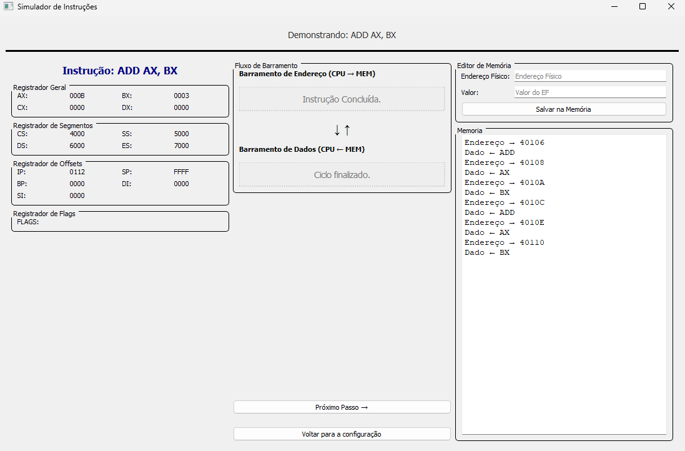

# x86 Instruction Simulator

An educational desktop application that shows, step by step, how an x86 CPU running in **real mode** executes assembly instructions: segment:offset address calculation, address and data bus activity, memory accesses and register contents.

Built with **Python** and **PyQt5** as an academic assignment (A3) for the *Computer Systems and Security* course.

> **Note:** the application interface is in Brazilian Portuguese.

## Screenshots



## Features

- **Step-by-step instruction cycle:** opcode fetch, operand fetch, decode, execute and write-back, advanced one step at a time.
- **Real-mode address calculation:** the physical address `(segment × 16) + offset` is shown for instruction fetch (`CS:IP`), data access (`DS:SI` / `DS:DI`) and stack operations (`SS:SP`).
- **Bus panels:** what travels on the address bus and on the data bus between CPU and memory at each step.
- **Register panel:** general (`AX`–`DX`), segment (`CS`, `SS`, `DS`, `ES`), pointer/offset (`IP`, `SP`, `BP`, `DI`, `SI`) and flags, all editable before running.
- **1 MB of memory** with a memory editor and an access log (little-endian, low byte at the lower address).

## Supported instructions

| Category | Instructions |
| --- | --- |
| Moves | `MOV`, `PUSH`, `POP`, `XCHG` |
| Arithmetic | `ADD`, `SUB`, `MUL`, `DIV`, `INC`, `DEC`, `NEG` |
| Boolean | `AND`, `OR`, `XOR`, `NOT` |
| Test / compare | `CMP` |
| Control flow | `JMP`, `JE`, `JNE`, `JG`, `JGE`, `JL`, `JLE`, `CALL`, `RET`, `IRET`, `LOOP` |
| I/O | `IN AX, port`, `OUT port, AX` |

## Tech stack

- Python
- PyQt5

## Running locally

Requires Python 3.8 or newer.

```bash
git clone https://github.com/brunocmg/x86-instruction-simulator.git
cd x86-instruction-simulator
pip install PyQt5
python main.py
```

## Usage

1. On the main menu, pick a category (Moves, Arithmetic, Boolean, Test/Compare) and then an instruction.
2. On the configuration screen, set the register values and the operands (`DST`, `SRC`, `ADDR` or `PORT`, depending on the instruction). All values are hexadecimal. Defaults: `CS=4000`, `SS=5000`, `DS=6000`, `ES=7000`, `IP=0100`, `SP=FFFF`.
3. Click **Demonstrar a execução da Instrução** (run the demonstration).
4. Advance with **Próximo Passo →** (next step) and follow the address bus, data bus, registers and memory log.
5. If an operand points to an empty memory position, fill it in using the memory editor, then continue.
6. When the instruction finishes, choose whether to keep the current state and configure the next instruction.

**Flags** are typed as text tokens (`ZF`, `SF`, `CF`, `OF`) in the flags field. `CMP` updates them and the conditional jumps read them (`JG`, `JGE`, `JL` and `JLE` use signed comparison, `SF` and `OF`).

## Limitations

- Educational simplification: opcodes are not real machine encodings, so the fetch phase only illustrates the access to `CS:IP`.
- Only `CMP` updates the flags (`CF`, `ZF`, `SF`, `OF`).
- `DIV` follows the 16-bit x86 form: it divides `DX:AX` by the operand (quotient in `AX`, remainder in `DX`), not the 8-bit `AL`/`AH` form.
- Only the address and data buses are shown; control bus signals are not simulated.
- Only `LOOP` is implemented (no `LOOPE` / `LOOPNE`).
- Real mode with 16-bit registers only.
- `IN` / `OUT` are simulated: the port value is entered through the memory editor.

## Original submission

The `original-submission/` folder keeps the file exactly as it was delivered for the assignment (`interface.py`), together with the files that were not used. The version in the root (`main.py`) is a corrected version of it.

Fixes in the corrected version:

- `JNE` now jumps when `ZF` is clear (it never jumped before).
- `IN` now finishes once the value is entered (the step used to repeat indefinitely).
- Instructions with a memory destination (`[SI]`, `[DI]`) now write to memory instead of overwriting the pointer register. `ADD`, `SUB`, `INC`, `DEC`, `NEG`, `AND`, `OR`, `XOR`, `NOT` and `XCHG` read the memory operand first, and `POP [SI]` / `POP [DI]` also work.
- `SF` is now computed from the sign bit of the 16-bit result, and `OF` was added, so `JG`, `JGE`, `JL` and `JLE` behave correctly for signed comparisons.
- A memory position filled with `0000` is now treated as filled (it used to be seen as empty).
- Starting a demonstration no longer overwrites a value you stored at `CS:IP`.
- `DIV` reports an error when the quotient does not fit in `AX`.
- Fixed on-screen messages (`POP`, `LOOP`, `PUSH`), the address error dialog, and unexpected errors no longer close the program.

## Project structure

```
.
├── main.py                      
├── original-submission/
│   ├── interface.py             
│   └── unused-files/            
└── docs/                        
```

## Team

- [Bruno Gomes](https://github.com/brunocmg)
- [Cauã Praxedes](https://github.com/Cauapm)
